---

## 👋 Sobre mim

Sou o **Gabriel (Lightz_Dog)**, dev e staff da **WinMC**, uma rede de Minecraft brasileira.
Cuido dos plugins, dos forks de servidor e da infraestrutura: de anticheat e anti-dupe
até economia, clãs, eventos e otimização pra aguentar muita gente em PvP.

- 🛠️ Plugins em **Java 21** pra **Paper** e **Folia** (multithread por região)
- ⚡ Forks do **Leaf 1.21.11** pra cada tipo de servidor da rede
- 🛡️ Segurança: anticheat, anti-ESP, anti-dupe e defesa contra backdoor
- 📱 Java e Bedrock juntos (Geyser + Floodgate)

---

## 🌍 A rede WinMC

<table>
<tr>
<td align="center" width="33%">⚔️ <b>Semi-Anarquia</b> survival com clãs, mercado e crystal PvP</td>
<td align="center" width="33%">🗡️ <b>Win Pit</b> The Pit num fork próprio do Leaf</td>
<td align="center" width="33%">🎉 <b>Eventos</b> minijogos e eventos com servidor dedicado</td>
</tr>
<tr>
<td align="center">🏰 <b>Guerra de clãs</b> batalhas entre clãs com kits e loot</td>
<td align="center">🥊 <b>Practice</b> duels, kits e ranqueadas</td>
<td align="center">🏠 <b>Lobby</b> hub da rede, Java e Bedrock</td>
</tr>
</table>

---

## 🧱 Projetos

### Forks de servidor
| Projeto | O que faz |
|---|---|
| **PitLeaf** | Fork do Leaf 1.21.11 otimizado pro Win Pit (testado com 35 bots lutando ao mesmo tempo) |
| **EventLeaf** | Fork do Leaf pro servidor de eventos: modo evento, spawn natural e sem farms |
| **winmcCore** | Launcher de mixins da rede, fork do Horizon (CanvasMC) compatível com os forks |

### Núcleo e gameplay
| Projeto | O que faz |
|---|---|
| **WinCore** | Núcleo da rede: RTP, chat, TPA, combate, 1v1 e configurações |
| **WinMarket** | `/sell`, `/worth`, `/ah` (leilão) e recompensas por cabeça |
| **WinKits** | Kits com menu próprio e entrega das compras da loja |
| **MyClans** | Clãs e o sistema de guerra |
| **MyHomes · MyTags · My3x3** | Homes, tags com menu Java/Bedrock e picaretas 3x3 |
| **VirtualBaus** | Baús virtuais por jogador com anti-dupe |
| **WinHolograms** | Hologramas 3D (texto, item e bloco) |
| **ArenaRegen · MyArena** | Snapshot e regeneração de arenas de PvP |

### Segurança
| Projeto | O que faz |
|---|---|
| **WinAntiESP** | Esconde baús, shulkers e spawners que o jogador não consegue ver |
| **GrimAC (fork)** | Anticheat com checks extras de crystal PvP |
| **AntiBackdoor** | Defesa leve contra plugins com backdoor |
| **MySafeArena** | Bloqueia itens proibidos por região |

### Integrações
| Projeto | O que faz |
|---|---|
| **BedrockUuid** | Corrige UUID de jogador Bedrock e faz a ponte com o Velocity |
| **LojaCentral** | Anúncios de compra em toda a rede |
| **MC-Linker** | Vincula a conta do Discord com a do Minecraft |

### 🔓 Público
| Projeto | O que faz |
|---|---|
| [**StrengthSMP-pack**](https://github.com/LightzDog0071/StrengthSMP-pack) | Resource pack com mochila 3D estilo Dora (pintável) e bazuca animada |

---

## 🧰 Tecnologias

 

 

---

## 📊 Atividade

<picture>
  <source media="(prefers-color-scheme: dark)" srcset="https://raw.githubusercontent.com/LightzDog0071/LightzDog0071/output/snake-dark.svg"/>
  <source media="(prefers-color-scheme: light)" srcset="https://raw.githubusercontent.com/LightzDog0071/LightzDog0071/output/snake.svg"/>
  
</picture>

---

⛏️ Feito com Paper, Folia e muito café · <a href="https://discord.gg/winmc">discord.gg/winmc</a>

